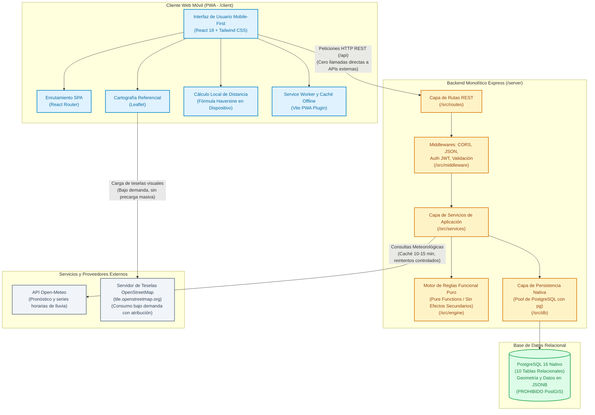
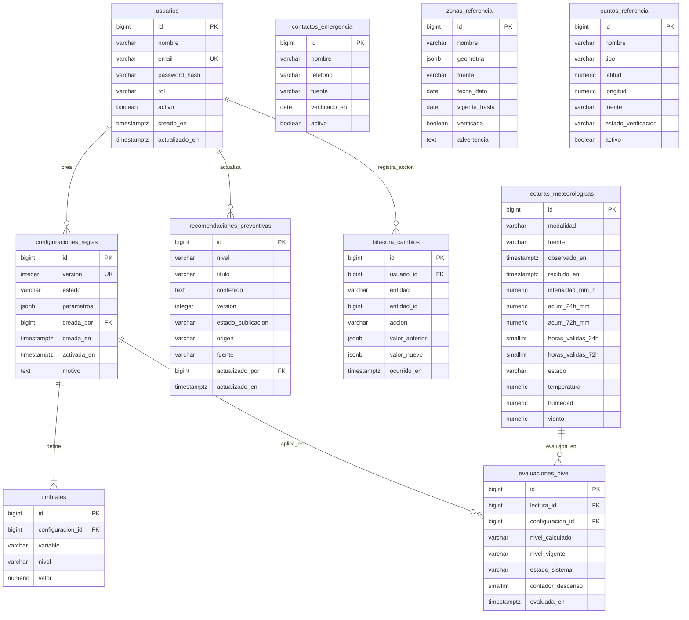

# PUKARA — Diagramas de Arquitectura y Modelo Entidad-Relación

**Sistema web móvil para la consulta de condiciones de lluvias intensas, clasificación informativa y recomendaciones preventivas en el sector Llojeta, La Paz.**

---

## 1. Arquitectura de Monolito en Capas (Figura 1)

El sistema PUKARA está estructurado bajo un patrón de **monolito modular en capas desacopladas**. El cliente móvil (PWA) interactúa de forma exclusiva con el backend a través de endpoints REST en `/api`, protegiendo la privacidad de la ubicación del usuario (cálculo Haversine en el cliente) y aislando la obtención de datos meteorológicos externos.

---

## 2. Diagrama Entidad-Relación de las 10 Tablas (Figura 2)

El esquema de base de datos de PUKARA se compone de **10 tablas inmutables**, normalizadas y protegidas mediante restricciones de integridad referencial, índices únicos parciales y tipos de datos `JSONB` nativos.

---

### Descripción de Relaciones y Cardinalidades

1. **`usuarios` -> `configuraciones_reglas` (1:N):**
   Un usuario administrador puede proponer y activar múltiples versiones de parámetros de evaluación (`creada_por`).
2. **`configuraciones_reglas` -> `umbrales` (1:N):**
   Cada versión de configuración contiene exactamente 9 tuplas de umbrales cuantitativos (3 métricas x 3 niveles superiores: `PRECAUCION`, `ALERTA`, `EMERGENCIA`). Al eliminarse una configuración, sus umbrales se eliminan en cascada (`ON DELETE CASCADE`).
3. **`configuraciones_reglas` -> `evaluaciones_nivel` (1:N):**
   Cada evaluación histórica queda referenciada a la versión inmutable de umbrales con la que fue calculada (`ON DELETE RESTRICT`).
4. **`lecturas_meteorologicas` -> `evaluaciones_nivel` (1:N):**
   Una lectura meteorológica (real o simulada) da origen a la evaluación del nivel informativo.
5. **`usuarios` -> `recomendaciones_preventivas` (1:N):**
   Un usuario administrador registra o actualiza el texto de las recomendaciones preventivas por nivel (`actualizado_por`).
6. **`usuarios` -> `bitacora_cambios` (1:N):**
   Toda acción administrativa queda registrada en auditoría vinculada al identificador del administrador responsable (`usuario_id`).
7. **Tablas de Catálogo y Consulta Directa:**
   `zonas_referencia`, `puntos_referencia` y `contactos_emergencia` funcionan de forma desacoplada para optimizar las consultas públicas en línea y fuera de línea (PWA Offline).
